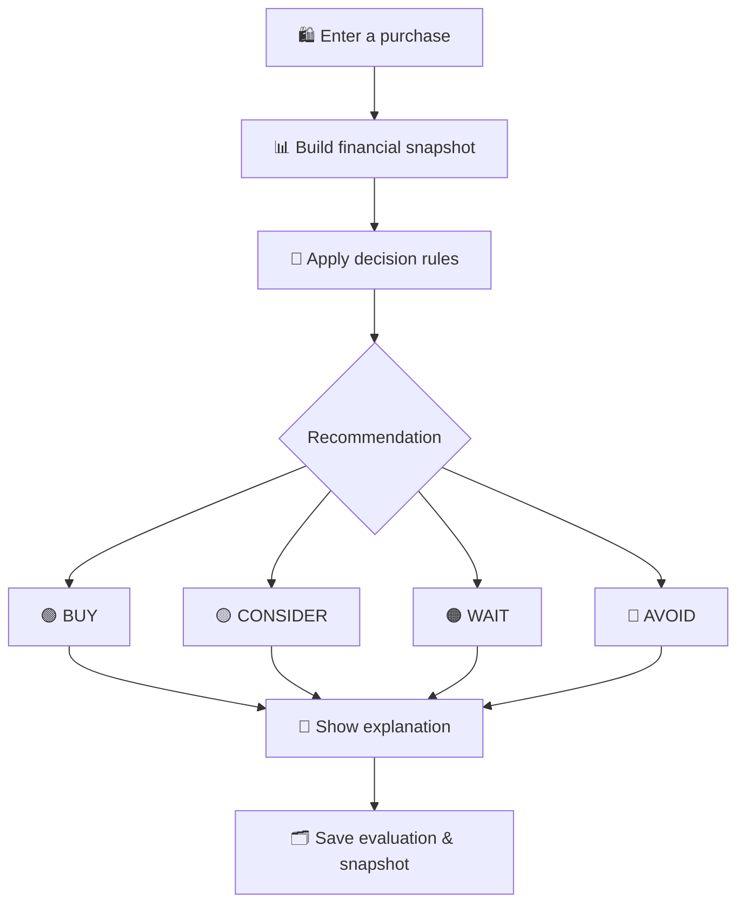
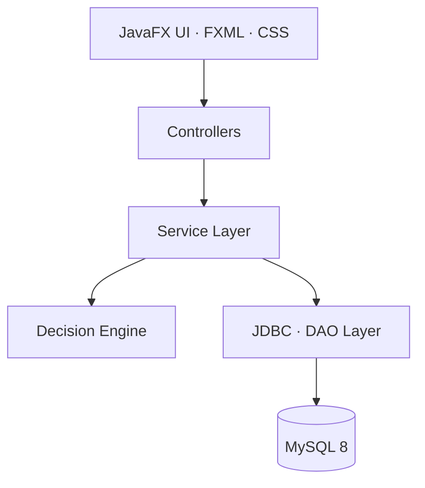

<div align="center">

# 💸 FinSense
### Financial Intelligent Decision System

**Spend Wisely · Decide Smartly · Save Better**

A smart Java desktop app that helps users manage money and make better purchase decisions.


</div>

---

## 🌟 What is FinSense?

FinSense goes beyond expense tracking. It analyses a user's **income, expenses, savings, commitments, goals, and spending behaviour** to help answer:

> **“Should I buy this now?”**

## 🚀 Features at a Glance

| 💰 Manage | 🧠 Decide |
|---|---|
| Income & expenses | Purchase recommendations |
| Savings goals & budgets | Behavioural assessment |
| Financial profile | What-if purchase simulator |
| Purchase history | Spending forecasts & insights |
| Monthly reports & CSV export | Smart purchase timing |

## ⚡ Purchase Advisor

Enter a product and price. FinSense evaluates the user's financial snapshot using transparent decision rules.



**Every recommendation includes an explanation.** The advisor is rule-based and provides decision support, not guaranteed financial advice.

## 🏗️ How It Is Built



### ☕ Java Concepts

**OOP** · Classes & Objects · Encapsulation · Inheritance · Abstraction · Interfaces · Polymorphism  
**Core Java** · Collections · Stream API · Lambda Expressions · Exception Handling · Records  
**Database & UI** · JDBC · JavaFX · FXML · Event Handling

## 🛠️ Tech Stack

| Java 21+ | JavaFX | JDBC | MySQL 8 | Maven | JUnit 5 |
|:---:|:---:|:---:|:---:|:---:|:---:|
| Core logic | Desktop UI | Connectivity | Storage | Build | Testing |

## ▶️ Run Locally

**Prerequisites:** JDK 21+ and MySQL 8.

```bash
git clone https://github.com/Vighnesh-SV/FinSense.git
cd FinSense
```

1. Copy `config/db.properties.example` to `config/db.properties`.
2. Add your local MySQL connection details.
3. Run the app (Windows):

```bat
mvnw.cmd javafx:run
```

Run tests:

```bat
mvnw.cmd clean test
```

> Keep your local database credentials private. Do not commit `config/db.properties`.

## 🎓 Demo Mode

Choose **Open the viva demo account** on the login screen.

| Username | Password |
|---|---|
| `demo_viva` | `DemoPass2026` |

The demo dataset is reset whenever the demo account is opened, keeping presentations consistent.

## 📚 Project Documentation

See **[Architecture & Viva Notes](docs/architecture-and-viva.md)** for architecture details, UML diagrams, database relationships, sequence diagrams, and viva questions.

---

<div align="center">

**Made with ☕ and Java**

*FinSense — Make every purchase a thoughtful decision.*

</div>
