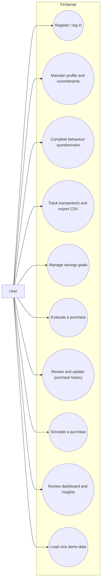
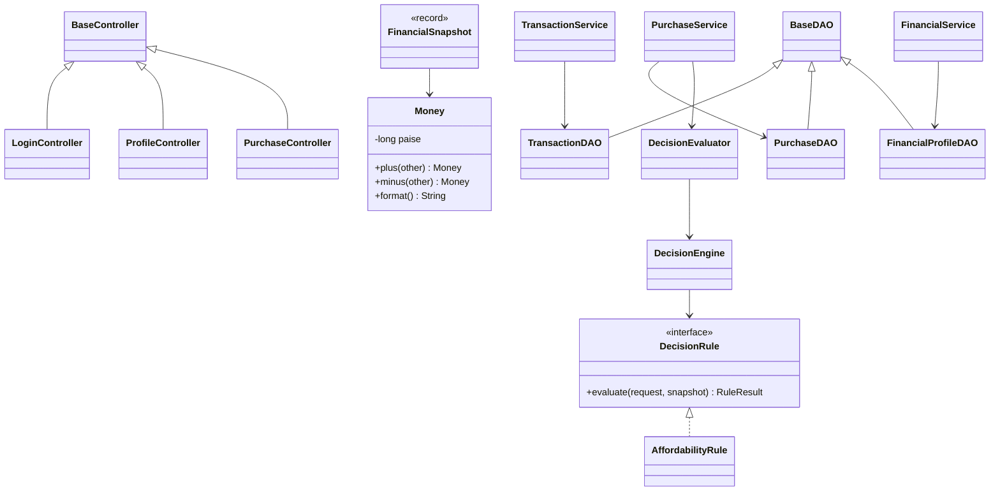
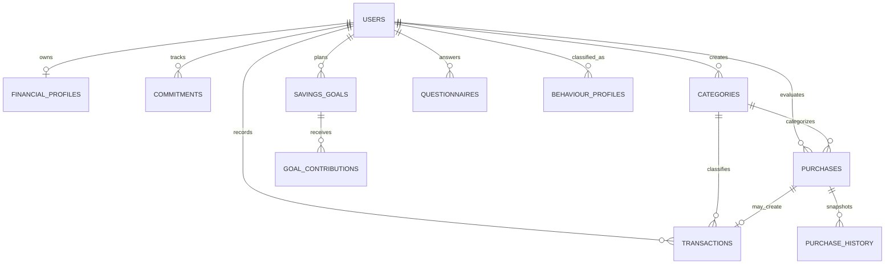
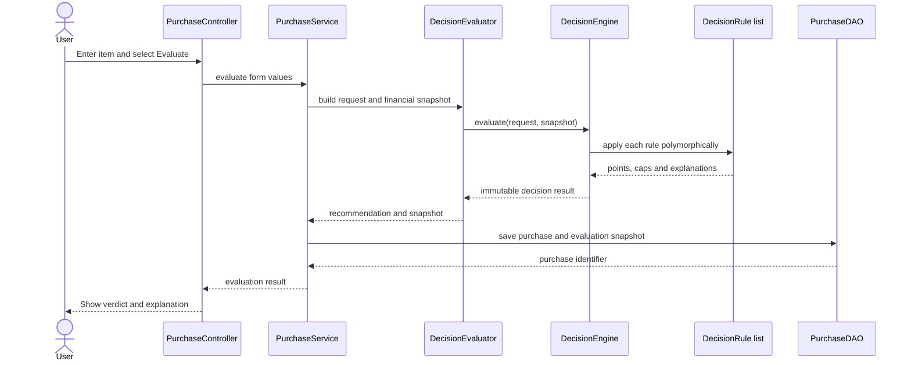
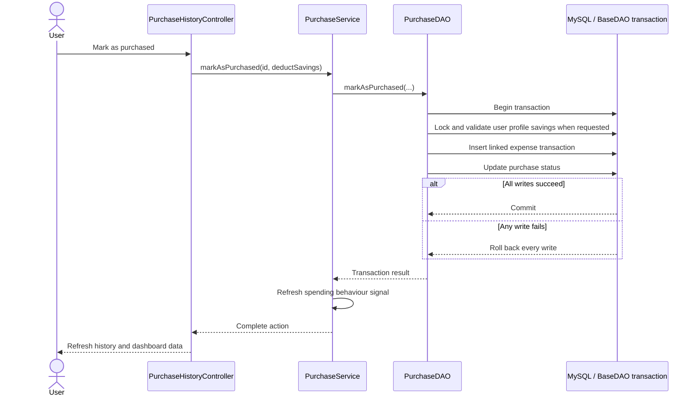

# FinSense (Financial Intelligent Decision System): architecture and viva notes

## Modules and architecture

FinSense uses a layered desktop architecture. JavaFX FXML and controllers form the presentation layer. Controllers read user input and call service methods; they do not own financial rules. Services validate use cases and coordinate model and DAO operations. Concrete JDBC DAOs extend `BaseDAO`, which centralizes parameter binding, row mapping, and transaction handling. MySQL stores user profiles, commitments, categories, purchases, evaluation snapshots, transactions, goals, contributions and behaviour history.

The main launcher is `com.finsense.Main`, which starts `FinSenseApp`. `SceneManager` swaps FXML roots in one application scene. `SessionManager` holds the authenticated user. User-owned DAO queries include the current `user_id`; built-in categories are shared while user-created categories are visible only to their owner.

Money is represented as immutable integer paise by `model.Money`, avoiding floating point rounding in financial calculations. The decision engine is intentionally separate from persistence: `DecisionEngine` evaluates an immutable snapshot through interchangeable `DecisionRule` implementations. `DecisionEvaluator` gathers the current user's data and delegates to the pure engine. `SimulationService` reuses the evaluation rules and projection calculations without writing records.

## Use-case diagram

## Class diagram

## Entity relationship diagram

## Purchase evaluation sequence

## Mark-as-purchased transaction sequence

## Viva questions and answers

| Question | Answer and concept | Example file |
|---|---|---|
| Why use a `Money` class? | It stores integer paise and returns new values from arithmetic, so currency avoids floating point errors and has immutability. | `src/main/java/com/finsense/model/Money.java` |
| How is the application divided into layers? | FXML/controllers handle interaction, services own use cases, DAOs own SQL, and models carry values. This is separation of concerns. | `src/main/java/com/finsense/service/PurchaseService.java` |
| Where is polymorphism used? | The engine holds a list of `DecisionRule` objects and calls each implementation through the interface. | `src/main/java/com/finsense/decision/DecisionEngine.java` |
| How does FinSense keep one user's data private from another? | DAO statements filter owned records using both record identity and `user_id`; shared categories are explicitly handled as a separate case. | `src/main/java/com/finsense/dao/TransactionDAO.java` |
| How does purchase marking remain consistent? | A JDBC transaction commits the expense insert and status change together, or rolls both back on failure. | `src/main/java/com/finsense/dao/PurchaseDAO.java` |
| Why are some classes records? | Records provide compact immutable data carriers with generated accessors and value semantics. | `src/main/java/com/finsense/decision/FinancialSnapshot.java` |
| Where are Java Streams useful? | They group transaction amounts by category and sum paise without explicit mutable accumulator loops. | `src/main/java/com/finsense/service/TransactionService.java` |
| How does the FXML connect to Java code? | `fx:controller` selects a controller, `fx:id` injects controls, and event handlers call annotated methods. | `src/main/resources/fxml/purchase.fxml` |
| How does constructor injection help? | Services accept their DAO dependencies in constructors, so tests can provide controlled dependencies. | `src/main/java/com/finsense/service/FinancialService.java` |
| Why does simulation avoid persistence? | It reuses evaluation and pure projection functions but never calls methods that insert purchases or transactions. | `src/main/java/com/finsense/service/SimulationService.java` |
| How is the demo loader repeatable? | It signs into the same demo identity and checks for the profile completion marker before seeding its related records again. | `src/main/java/com/finsense/util/DemoDataLoader.java` |
